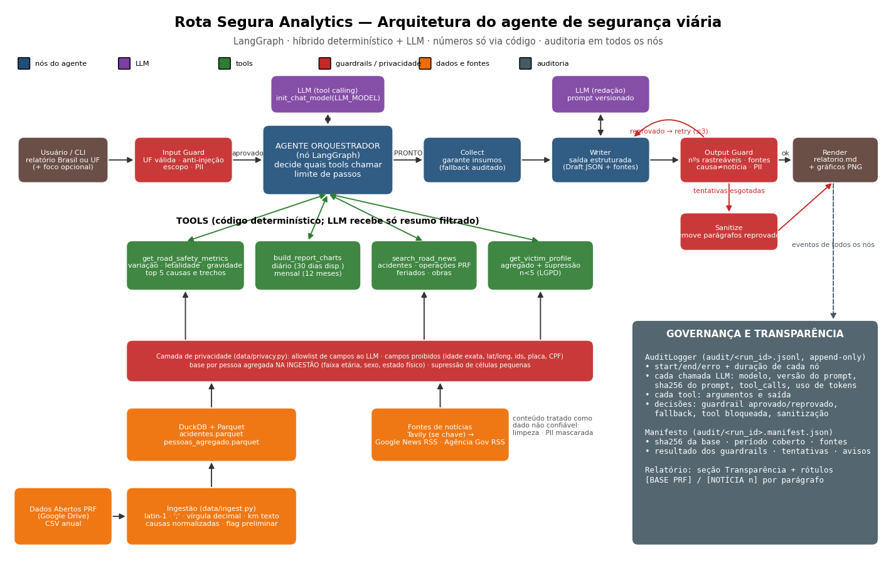

# Rota Segura Analytics — Agente de Monitoramento de Acidentes em Rodovias Federais

PoC de IA generativa: um **agente LangGraph** que consulta a base aberta de acidentes da **PRF** e notícias
recentes para gerar um relatório de segurança viária (Brasil ou UF), com métricas calculadas por código e
comentários do LLM **rotulados por fonte, validados por guardrails e auditados**.

- 📄 Diagrama da arquitetura: [`docs/arquitetura.pdf`](docs/arquitetura.pdf)
- 📊 Relatórios de exemplo: [`reports/exemplos/BR`](reports/exemplos/BR/relatorio.md) · [`reports/exemplos/SC`](reports/exemplos/SC/relatorio.md)
- 🧾 Trilhas de auditoria dos exemplos: [`reports/exemplos/auditoria`](reports/exemplos/auditoria)
- 📐 Especificação (SDD/Kiro): [`.kiro/specs/relatorio-seguranca-viaria`](.kiro/specs/relatorio-seguranca-viaria)



---

## Como rodar

```bash
python -m venv .venv
.venv/Scripts/pip install -e ".[dev]"        # Linux/macOS: .venv/bin/pip
cp .env.example .env                           # coloque sua GOOGLE_API_KEY (Gemini Flash, plano gratuito)

rota-segura ingest                             # baixa e normaliza a base PRF (2024–2026)
rota-segura report                             # relatório Brasil
rota-segura report --uf SC --focus "feriados e obras na BR-101"
rota-segura report --uf SC --offline           # sem chave de API: LLM determinístico (mesmo grafo)
rota-segura report --uf SC --news-from reports/exemplos/SC/noticias.json  # replay das mesmas notícias
pytest -q && ruff check src tests
```

Saídas: `reports/<UF>-<run_id>/relatorio.md` (+ PNGs e `noticias.json`, snapshot com hash no manifesto) e `audit/<run_id>.jsonl` + `audit/<run_id>.manifest.json`.

> Os exemplos versionados foram gerados em **modo offline** (sem chave de LLM disponível no ambiente de
> desenvolvimento). Métricas, gráficos, notícias, guardrails e auditoria são reais; só a redação vem do
> redator-template. Com `LLM_MODEL` + chave, o mesmo fluxo usa o LLM real.

---

## 1. Escolha da arquitetura

**Híbrida: determinística para números, agente para orquestração e linguagem.**

| Decisão | Motivo |
|---|---|
| **LangGraph `StateGraph` com nós explícitos** (`input_guard → orchestrator ⇄ tools → collect → writer → output_guard → render`) | Fluxo previsível e auditável; cada nó tem uma responsabilidade. Um ReAct livre seria mais difícil de governar. |
| **Orquestrador LLM com tool calling** | O agente decide a ordem/uso das tools (requisito do desafio), com allowlist, limite de passos e bloqueio de chamadas repetidas. |
| **Nó `collect` com fallback** | Se o LLM pular uma tool obrigatória, o sistema executa e **registra a decisão** — o relatório nunca sai sem métricas. |
| **Writer com saída estruturada** (`Draft` pydantic) | Cada parágrafo traz `sources` (`BASE` / `NEWS:n`), o que torna a validação automática possível. |
| **DuckDB sobre Parquet** | SQL rápido, sem servidor, consultas legíveis e reproduzíveis (hash da base no manifesto). |
| **Provedor de LLM plugável** (`init_chat_model`) | Padrão: **Gemini Flash** (plano gratuito do Google AI Studio). Troca de modelo por variável de ambiente; modo offline para testes/CI. |

Por que **não** RAG/banco vetorial: as métricas são agregações exatas sobre dados tabulares — recuperação
semântica traria imprecisão onde precisamos de exatidão. Notícias são poucas e recentes; busca direta basta.

## 2. Uso de tools

| Tool | O que faz | O que o LLM recebe |
|---|---|---|
| `get_road_safety_metrics` | Variação, letalidade, gravidade, top 5 causas e trechos (DuckDB) | Resumo JSON já validado pela allowlist de privacidade |
| `build_report_charts` | Gráficos diário (30 dias disponíveis) e mensal (12 meses) | Só os nomes dos arquivos |
| `search_road_news` | Tavily (se houver chave) → Google News RSS + Agência Gov RSS; dedup, filtro de data, PII mascarada | id, título, fonte, data |
| `get_victim_profile` | Perfil agregado (faixa etária, sexo, tipo de envolvido) de vítimas graves/fatais | Contagens com supressão `<5` |

As tools executam código determinístico; o resultado completo fica no `ToolContext` (usado pelo render) e
o LLM só vê o resumo necessário.

## 3. Métricas e definições

- **Período atual** = últimos 30 dias **disponíveis** (até a data máxima da base), não o calendário. A base
  atrasa ~1 mês — no exemplo, o dado mais recente é **31/08/2026** para um relatório gerado em 26/10/2026.
  O relatório mostra isso no topo.
- **Variação** = (atual − anterior) / anterior, anterior = 30 dias imediatamente antes.
- **Letalidade** = mortos / acidentes × 100. **Gravidade** = % de acidentes com ≥1 ferido grave ou morto.
- **Trecho** = UF + BR + km inteiro (segmento de 1 km); ordenado por nº de acidentes, desempate por mortos e graves.
- **Dados preliminares**: ano corrente (e o anterior até a revisão de março) é sinalizado no relatório.

Tratamentos da base (`data/ingest.py`): latin-1, separador `;`, vírgula decimal em km/lat/long, `NA` → nulo,
causas com grafias diferentes unificadas por chave sem acento/caixa + renomeações conhecidas
(`data/causes.py`), descarte do `id` e colunas operacionais.

## 4. Guardrails

**Entrada** (`validate_request`, antes de qualquer chamada ao LLM): UF válida; foco ≤ 200 caracteres, dentro do
escopo, sem padrões de injeção de prompt e sem PII.

**Saída** (`validate_draft`, após o writer):
1. Todo parágrafo precisa de fonte; IDs de notícia precisam existir.
2. **Números rastreáveis**: em parágrafos `BASE`, todo número precisa existir no `MetricsBundle`
   (aceita formato pt-BR e arredondamento de 1 casa). Pega alucinação numérica.
3. **Causa ≠ notícia**: parágrafo que cita notícia não pode ter linguagem causal ("causado", "devido a",
   "provocado"…). Causas só vêm da base.
4. **PII**: CPF, placa, e-mail, telefone bloqueados.

Reprovou → o writer recebe os problemas e tenta de novo (até 3x). Esgotou → `sanitize` remove só os
parágrafos reprovados, adiciona aviso e o relatório sai com todas as métricas.

Prompts: notícia é delimitada como **dado não confiável** (`<noticias>`), o orquestrador ignora instruções
vindas de resultados de tools, e o writer é instruído a usar linguagem de hipótese ao relacionar fontes.

## 5. Governança e transparência

- `audit/<run_id>.jsonl` (append-only): início/fim/erro e duração de cada nó; cada chamada ao LLM com modelo,
  versão do prompt, **sha256 do prompt**, tool calls e uso de tokens; cada tool com argumentos e saída;
  cada **decisão** (guardrail aprovado/reprovado, fallback, tool bloqueada, sanitização).
- `audit/<run_id>.manifest.json`: sha256 da base, data máxima, período, fontes de notícia, resultado dos
  guardrails, tentativas, avisos, caminho do relatório.
- No relatório: rótulos **[BASE PRF]** / **[NOTÍCIA n]** por parágrafo, lista de notícias com link e seção
  *Transparência e governança*.
- Prompts versionados (`agent/prompts.py::PROMPT_VERSION`).

## 6. Dados sensíveis (LGPD)

A base "por pessoa" tem idade, sexo, estado físico e tipo de envolvido. Política (`data/privacy.py`):

| Dado | Tratamento |
|---|---|
| Linhas individuais (por pessoa) | **Nunca** gravadas em `processed/`: agregadas na ingestão (dia × UF × faixa etária × sexo × estado físico × envolvido) |
| Idade exata | Convertida em faixas (0-17, 18-29, 30-44, 45-59, 60+); idades impossíveis → "Não informado" |
| Recortes pequenos | Células com n < 5 → `"<5"` (evita reidentificação, ex.: "mulher 60+ morta no km X no dia Y") |
| `id`, `pesid`, `id_veiculo`, marca, ano do veículo, lat/long, horário, município | Proibidos no contexto do LLM (`FORBIDDEN_FIELDS`) |
| Contexto do LLM | `assert_llm_safe`: allowlist de chaves de topo + busca recursiva de campos proibidos |
| Testemunhas | Excluídas do perfil de vítimas |
| Notícias | PII (CPF, placa, e-mail, telefone) mascarada antes de entrar no prompt; saída também é checada |

Limitação conhecida: supressão primária apenas (sem supressão complementar); aceitável para PoC, ver backlog.

## 7. Clean code e testes

- Camadas separadas: dados (`data/`), métricas puras (`metrics.py`), agente (`agent/`), políticas
  (`guardrails.py`, `data/privacy.py`), auditoria (`audit.py`), apresentação (`report.py`, `charts.py`).
- Tipos com pydantic; nada de dicionário solto atravessando camadas.
- **36 testes** (`pytest`): parsing real do formato PRF, métricas sobre base sintética com resultado
  conhecido, privacidade, guardrails (injeção, alucinação numérica, causa de notícia, PII) e o grafo ponta a
  ponta — inclusive um LLM "preguiçoso" (não chama tools) e um "alucinador" (fallback e sanitização auditados).
- `ruff check` + `ruff format` limpos.

## 8. Desenvolvimento guiado por especificação (SDD) e economia de tokens

O repositório segue o formato do **Kiro**:

- `.kiro/steering/{product,tech,structure}.md` — contexto permanente (regras, stack, mapa do código).
- `.kiro/specs/relatorio-seguranca-viaria/requirements.md` — requisitos em **EARS**.
- `design.md` — arquitetura e decisões. `tasks.md` — tarefas rastreadas a requisitos.

`CLAUDE.md` é curto e **aponta** para esses arquivos em vez de duplicá-los, então o assistente lê só o que
precisa. Fluxo: requisito → design → tarefa → código → teste → marcar tarefa.

## Estrutura

```
src/rota_segura/  config · data/{ingest,causes,privacy} · metrics · charts · news
                  guardrails · audit · report · cli · agent/{graph,tools,prompts,offline}
tests/            ingest · metrics · privacy · guardrails · graph
docs/             arquitetura.pdf/.png + script gerador
reports/exemplos/ relatórios BR e SC + trilhas de auditoria
.kiro/            steering + specs (SDD)
```

## Próximos passos

Ver `tasks.md`: conjunto *golden* de avaliação para guardrails/alucinação, exemplos com LLM real, supressão
complementar, cache de notícias por execução e interface web.
