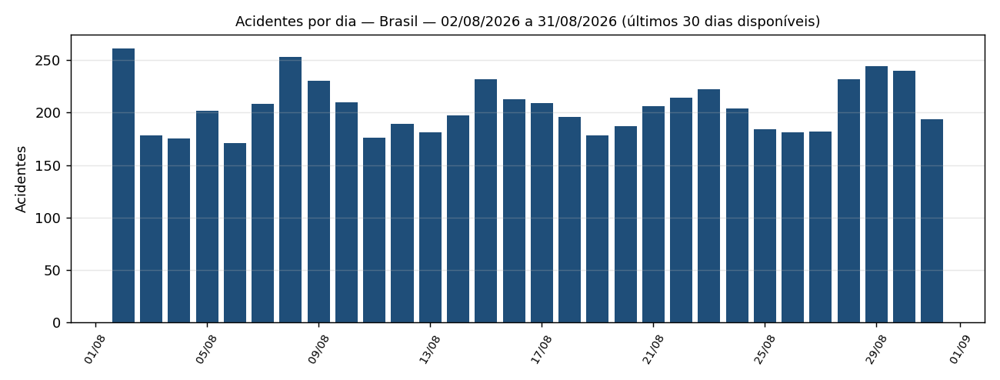
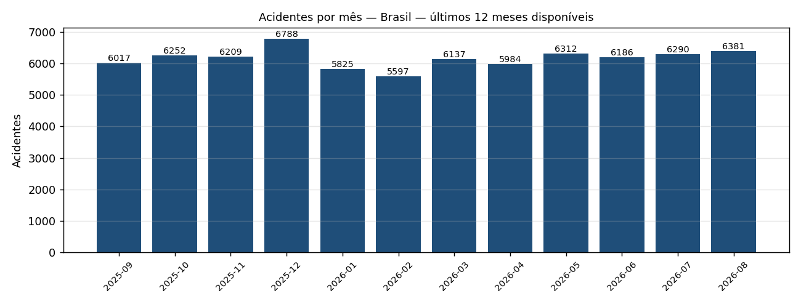

# Relatório de Segurança nas Rodovias Federais — Brasil

> **Período coberto (base PRF):** 02/08/2026 a 31/08/2026 — últimos 30 dias **disponíveis**.
> A base da PRF é publicada com atraso de ~1 mês; o dado mais recente disponível é de
> **31/08/2026** (não é o calendário de hoje, 26/10/2026).
> **Comparação:** 03/07/2026 a 01/08/2026 (30 dias imediatamente anteriores).
> ⚠️ **Dados preliminares:** o ano corrente ainda está sujeito a revisão pela PRF (consolidação em janeiro, revisão em março).

**Resumo:** Brasil: 6149 acidentes nos últimos 30 dias disponíveis (-0,53% frente ao período anterior).

## 1. Indicadores principais **[BASE PRF]**

| Indicador | Valor | Definição |
|---|---:|---|
| Acidentes no período | 6.149 | ocorrências registradas pela PRF |
| Acidentes no período anterior | 6.182 | 30 dias imediatamente anteriores |
| Variação | -0,53% | (atual − anterior) / anterior |
| Mortos | 588 | soma de óbitos nas ocorrências |
| Taxa de letalidade | 9,56 | mortos por 100 acidentes |
| Taxa de gravidade | 29,53% | acidentes com ≥1 ferido grave ou morto / acidentes |

### Top 5 causas **[BASE PRF]**

| # | Causa | Acidentes | % do total | Mortos |
|---|---|---:|---:|---:|
| 1 | Ausência de reação do condutor | 1008 | 16,39% | 66 |
| 2 | Reação tardia ou ineficiente do condutor | 977 | 15,89% | 66 |
| 3 | Acessar a via sem observar a presença dos outros veículos | 565 | 9,19% | 46 |
| 4 | Manobra de mudança de faixa | 392 | 6,38% | 32 |
| 5 | Condutor deixou de manter distância do veículo da frente | 390 | 6,34% | 1 |

### Top 5 trechos críticos (UF + BR + km) **[BASE PRF]**

Trecho = segmento de 1 km (km inteiro). Ordenação: nº de acidentes; desempate por mortos e acidentes graves.

| # | Trecho | Acidentes | Mortos | Acidentes graves/fatais |
|---|---|---:|---:|---:|
| 1 | SC · BR-101 · km 207 | 10 | 1 | 3 |
| 2 | SP · BR-116 · km 230 | 8 | 0 | 1 |
| 3 | RJ · BR-116 · km 185 | 7 | 1 | 3 |
| 4 | RJ · BR-040 · km 121 | 7 | 0 | 3 |
| 5 | SC · BR-101 · km 214 | 7 | 0 | 1 |

## 2. Gráficos **[BASE PRF]**

## 3. Perfil agregado das vítimas graves e fatais **[BASE PRF — anonimizado]**

Contagens agregadas da base "por pessoa"; células com menos de 5 pessoas aparecem como `<5` (LGPD).

**Faixa etaria:** Lesões Graves · 30-44: 579; Lesões Graves · 18-29: 555; Lesões Graves · 45-59: 373; Lesões Graves · 60+: 196; Lesões Graves · 0-17: 124; Óbito · 30-44: 174; Óbito · 45-59: 146; Óbito · 18-29: 113; Óbito · 60+: 95; Óbito · 0-17: 60

**Sexo:** Lesões Graves · Masculino: 1352; Lesões Graves · Feminino: 473; Lesões Graves · Não informado: <5; Óbito · Masculino: 453; Óbito · Feminino: 133; Óbito · Não informado: <5

**Tipo envolvido:** Lesões Graves · Condutor: 1193; Lesões Graves · Passageiro: 520; Lesões Graves · Pedestre: 112; Lesões Graves · Cavaleiro: <5; Óbito · Condutor: 353; Óbito · Passageiro: 159; Óbito · Pedestre: 76

## 4. Análise e contexto (gerado por IA, validado por guardrails)

Cada parágrafo indica sua fonte: **[BASE PRF]** = calculado da base oficial; **[NOTÍCIA n]** = notícia listada na seção 5 (contexto, sem verificação contra registros individuais da base).

### Visão geral

**[BASE PRF]** Em Brasil, foram registrados 6149 acidentes no período, contra 6182 no período anterior (-0,53%), indicando tendência de estável. A letalidade foi de 9,56 mortes por 100 acidentes e 29,53% dos acidentes tiveram feridos graves ou mortos.

### Causas e trechos críticos

**[BASE PRF]** A causa mais frequente na base foi "Ausência de reação do condutor", com 1008 acidentes (16,39% do total). O trecho mais crítico foi SC BR-101 km 207, com 10 acidentes.

### Contexto das notícias

**[NOTÍCIA 1]** Entre as notícias recentes, destaca-se: "Caminhoneiro receberá pensão pelo resto da vida após acidente na BR-116 - Estadão" (Estadão). A notícia é apresentada como contexto e não foi cruzada com registros individuais da base.

## 5. Notícias consultadas

1. [Caminhoneiro receberá pensão pelo resto da vida após acidente na BR-116 - Estadão](https://news.google.com/rss/articles/CBMiwgFBVV95cUxPeWM3Qmx5dHdUX2FCcmNDSk9ZTGE0ejJ6bmI0Z24teFJibE9oSTdTNXlwb1REYTJBeHFVZUIzbjhrTjdmM0Z3QTJHOGUtSGNPa09vbFE5ZDMySllPb2NCM2dFZ29kSy1XTVJZVU9fZGtaMGVxRWZWWUUzQ0trbUhYQ1hBXzFQdDlPUHl1YXhyNGJfbWNzSWt5SEh6WUNSQ0hZTlFsSEJ2S295VEtncnZwWWxZUHJHUmo0TUd4VUcxeGRpUdIBxwFBVV95cUxNQ3BfQ090VnZyRjZOYVBrbzZwZGhYeldRR1MxMUVpQW9HQVItOHQwZjBHaDdycDRlX05FUFBOTXIzWmkzUnhXN3VWQ0RTUkJoY0xnTkxSaXlTak9kZlc0OXVWYklVbFM4ZDN5TVRVSjZCMnJubHkxTDFpbXFfMzc5N1N1QmFScEZPQlFYMEtoYXF3UDZyeVpJQlQxSFhDTms5MXJlRVdLdG1Sb2J2WFFTV080YnM0bW53bHVnbzg1WEVWMkRLMVdF?oc=5) — Estadão, 2026-10-26 _(via google_news_rss)_
2. [Motocicletas colidem e duas pessoas morrem em acidente na BR-232, em Vitória de Santo Antão - Terra](https://news.google.com/rss/articles/CBMi_wFBVV95cUxORUsycHVpOC1jSVRDblMzZEpmdDRJNndiRjV4N2Y2SUNnTWpRZmdRbDMtb1JUTkQ0R3Z2MGNBLU0zQ29pdmMwVm1QYTAzMTFSVzZabUZLOExWOW1rSWlueU0wQ2loNEwxaHZQNDRhbHdUS3B3N3ZlbXV5d1F6RTZZT1dMam1LVTh6T3ZrOFNYbFlIUHRUMHI1X1ZXZDhNMWtpWVFnTTdjRU92d1EzX2xTVHhVRTBQYVZKUndIbERhQWNnS2N4YzJkbW9GQ29uS09GcWxhOTdudURLMTJTc0VVdnJUekNlSzU2ZmpwRDUwRktwS0ctTXQzZmVUMF9VRVU?oc=5) — Terra, 2026-10-25 _(via google_news_rss)_
3. [Sobrinho de Dilma, deputado federal Pedro Rousseff sofre acidente de carro - O GLOBO](https://news.google.com/rss/articles/CBMi0AFBVV95cUxNUWYzOHRSTHJsNlBzWnNscHhpTUhsQWxxbjlXZGdCMG5IRHhtZlZRZlFvR2VIYmtfMGI1bG9NRG5XYU9TNE40RzdXR3p5aWJhUGY3V3RuS0tGWUVNT1VRS1FsaWRGdnV5OVd5NXNSc1BOZlNWX2NDTkxXNHpvdTVYZXVpRzlBZmY1OEt6ZFRIZzhGRGZLLVFVaU1pOENjb1ZHNzk1Q0RqLTJhZEF3UnBoeW9LekNpLTE5akhianhVRzVOQnROQ2dLUFdPM180VG450gHfAUFVX3lxTE9IcjdHUXh1aEEtR056WlhvbXM4ZkNKTkRWald0T0VublFiekRRNGFpNHlTWXAzZTJYVS1RTzUyREQ4eEhCdTZvWlVLY1RRc3ZTdWNOOC1LSVFVZFgwNE1ONm9XcW03UUhXQjhNSW8tNXlONFMycGVvOUFDTFdjQ284ZGtJQ3lTNWVpZE4yZ1VSSDBHXzBHeldIVnhtRjNGLVBUYUd5djhIbDhlcHNhZVFiRFRaNDlqaTBpbVRDcmxUNHBObWlUNmFyUFRxMk5yYlU2MkVxQTROb1I0aG1qZWc?oc=5) — O GLOBO, 2026-10-25 _(via google_news_rss)_
4. [Ministério da Justiça faz operação para garantir segurança no 2º turno - Agência Brasil](https://news.google.com/rss/articles/CBMixgFBVV95cUxQU3NZeWJpUWxvVWVUMmMxcjBTelJHRks3STlIYjVFMzZwQ1kxc0ZYeWRXLUp0akR2bDZYalZqbDdsOU8zaVNxVnN3WGVISTMwclFUZWNtRVEzcHV2VUhkRjE1eXBLTWNUMnpUVTNYNlpUWnVxVzE3V0o3MjRrRTZXc2h5MlV4TThudDF0TFVmSFJfdnJxR3pJckx6Y2huOGJybnNTVHI3RnlNVnFxeG0zVTJ5amgwVUhDeWYzdm5KVElyQ0FyMXc?oc=5) — Agência Brasil, 2026-10-24 _(via google_news_rss)_
5. [PRF apreende 49 kg de skunk em caminhão durante Operação Eleições 2026 no Ceará - G1](https://news.google.com/rss/articles/CBMizwFBVV95cUxNQ251MEwya3FjZV9FYnMwYlZfV0Z1SHE4T0cySXJnb052SjlCcGFBcUgxVWtFOGt1d0pxTTI1di1UcTI0QndjQWF5alFJRlJNNUJwUG5EeXZ3b2g5YXYydjlvZXEzNmNtSkw2T2l0UXlWaUxwc016TzBTMkFSaWtqLXp1MVBaWHhlaTU4UlVvRldPcTY3RlVIMk1GeG82ZDBpc3ZVZlRsV0tJQTJ0MkhjQ1JsdTNHWmctYlo2Q0gxOTNQV3h1VlBlWFYwdFh4TUk?oc=5) — G1, 2026-10-26 _(via google_news_rss)_
6. [PRF lança Operação Nossa Senhora Aparecida 2026 com reforço na fiscalização e emprego de tecnologia - Governo Federal](https://news.google.com/rss/articles/CBMi8gFBVV95cUxPZWRvbXdKYWJqaGpQTFkxeEFXOUdFNlMtbDNrbkxXb3JCaTdab0FLSTgzQ2V3Z0VOMC0wcm9uaG1PMGpzUVg4SkU1QjZDSEx1dElUU3AyYUFrS2lyVkxNZzRjRmNhejJ1ZURKSDR5MWxyWmZFNmk2b0RCVE1UUlRaNmlHQ19VYXNrOTVIZFA1b05PN1JHUXUtV3NoT0dzamZnZUJCaHk0X0JNS09JNnVBNm05OUZiZUJEOXZ5YTBENlVwRFN6TWdBcXhYcjVtRHNsVG1qSzdNRUd3TEhxN1V0RXp0aGRXTU50R0FXVW9rRXE1QQ?oc=5) — Governo Federal, 2026-10-08 _(via google_news_rss)_
7. [CET monta “Operação Estrada” para o feriado prolongado de 12 de outubro - Prefeitura](https://news.google.com/rss/articles/CBMi_gFBVV95cUxQeExQcGc5SlhHV1ZlSnFPRGxkR2dxdXB4V0g4V1QyMkI3dzJua2M5OWROM0dvZ2ZLNWdkbFBfQWJhd0dycjdrX3hjd3BoZHUyc2ZZMGZlS05fbGFKVU5lTFVOdkRic0ZnVXlVM0xiOFpkaEhnOG9aOWVpTGJ5eUpVbzBwOGRHQUxuTldaQlRST3JmNVJGQWxRSGowOVg0em81VWMxNWZVckptb0JkaGhxeEFENUhBS3lqMGRrTlJjRXF2OGl3NW1OZHZ4YWRkOTNGVERVenE0N3dTN2FaMEM0aFJXc3ZEQTlvMlRaNFFoOUFGcmxCVm03V2FtRHlZZw?oc=5) — Prefeitura, 2026-10-19 _(via google_news_rss)_
8. [Renovias registra quinto feriado prolongado de 2026 sem mortes nas rodovias - Renovias](https://news.google.com/rss/articles/CBMiogFBVV95cUxNSFE2UkZEU2tQdzVMTzZ2OVM1Nng5d3F1a2xHVlFkaGlsemhzcmtHbUhjSTVCRW44VzZ1YzVJNzRqbFhabzdVM3E1eWVLb0QyelVnanhMbmwxOGJTU1RwQ2F4T2NPS09jamtyRi0yX3NZV05xaW5hM0ZZUExsVjNTTUt0QWp3dm9adllmaFNaUURGdS12MUtlcmI2Um1WZVJQNXc?oc=5) — Renovias, 2026-10-13 _(via google_news_rss)_

## 6. Transparência e governança

- **Execução:** `20261026-212647-c1c071` · trilha de auditoria em `audit/20261026-212647-c1c071.jsonl` e manifesto em `audit/20261026-212647-c1c071.manifest.json`.
- **Modelo de linguagem:** `offline:template-writer` · versão dos prompts `2026-10-26.1`.
- **Guardrails de saída:** aprovado após 1 tentativa(s).
- **Origem dos números:** todas as métricas, tabelas e gráficos são calculados por código determinístico (DuckDB) sobre a base aberta da PRF; o LLM apenas redige comentários e é verificado contra esses números.
- **Notícias:** usadas apenas como contexto. O agente é proibido de atribuir causa a um acidente específico noticiado; causas vêm exclusivamente da base.
- **Dados pessoais (LGPD):** nenhum registro individual é enviado ao LLM; a base por pessoa é agregada na ingestão e células pequenas são suprimidas.
- **Fonte dos dados:** [Dados Abertos da PRF](https://www.gov.br/prf/pt-br/acesso-a-informacao/dados-abertos/dados-abertos-da-prf).