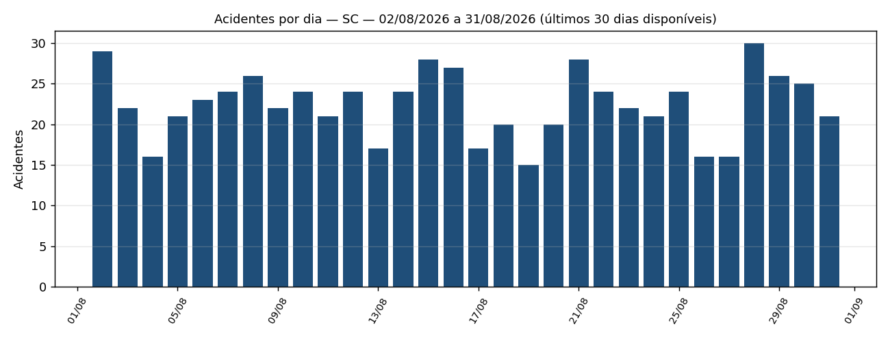
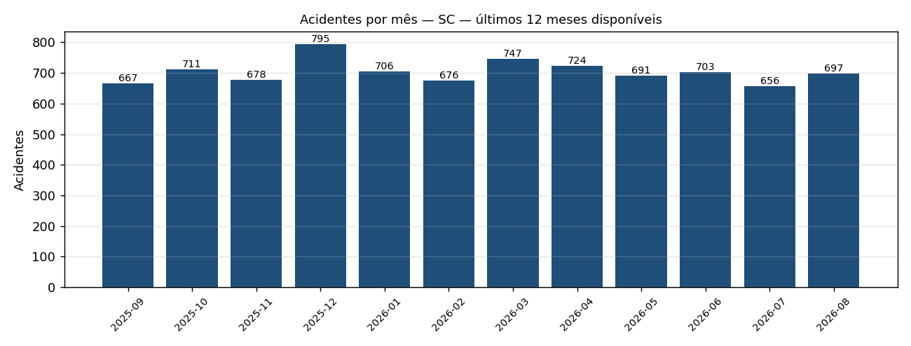

# Relatório de Segurança nas Rodovias Federais — SC

> **Período coberto (base PRF):** 02/08/2026 a 31/08/2026 — últimos 30 dias **disponíveis**.
> A base da PRF é publicada com atraso de ~1 mês; o dado mais recente disponível é de
> **31/08/2026** (não é o calendário de hoje, 26/10/2026).
> **Comparação:** 03/07/2026 a 01/08/2026 (30 dias imediatamente anteriores).
> ⚠️ **Dados preliminares:** o ano corrente ainda está sujeito a revisão pela PRF (consolidação em janeiro, revisão em março).

**Resumo:** SC: 673 acidentes nos últimos 30 dias disponíveis (4,50% frente ao período anterior).

## 1. Indicadores principais **[BASE PRF]**

| Indicador | Valor | Definição |
|---|---:|---|
| Acidentes no período | 673 | ocorrências registradas pela PRF |
| Acidentes no período anterior | 644 | 30 dias imediatamente anteriores |
| Variação | 4,50% | (atual − anterior) / anterior |
| Mortos | 34 | soma de óbitos nas ocorrências |
| Taxa de letalidade | 5,05 | mortos por 100 acidentes |
| Taxa de gravidade | 22,29% | acidentes com ≥1 ferido grave ou morto / acidentes |

### Top 5 causas **[BASE PRF]**

| # | Causa | Acidentes | % do total | Mortos |
|---|---|---:|---:|---:|
| 1 | Reação tardia ou ineficiente do condutor | 134 | 19,91% | 6 |
| 2 | Ausência de reação do condutor | 104 | 15,45% | 2 |
| 3 | Acessar a via sem observar a presença dos outros veículos | 61 | 9,06% | 3 |
| 4 | Ingestão de álcool pelo condutor | 50 | 7,43% | 1 |
| 5 | Manobra de mudança de faixa | 48 | 7,13% | 1 |

### Top 5 trechos críticos (UF + BR + km) **[BASE PRF]**

Trecho = segmento de 1 km (km inteiro). Ordenação: nº de acidentes; desempate por mortos e acidentes graves.

| # | Trecho | Acidentes | Mortos | Acidentes graves/fatais |
|---|---|---:|---:|---:|
| 1 | SC · BR-101 · km 207 | 10 | 1 | 3 |
| 2 | SC · BR-101 · km 214 | 7 | 0 | 1 |
| 3 | SC · BR-282 · km 0 | 7 | 0 | 1 |
| 4 | SC · BR-101 · km 206 | 7 | 0 | 0 |
| 5 | SC · BR-282 · km 1 | 7 | 0 | 0 |

## 2. Gráficos **[BASE PRF]**

## 3. Perfil agregado das vítimas graves e fatais **[BASE PRF — anonimizado]**

Contagens agregadas da base "por pessoa"; células com menos de 5 pessoas aparecem como `<5` (LGPD).

**Faixa etaria:** Lesões Graves · 30-44: 52; Lesões Graves · 18-29: 52; Lesões Graves · 45-59: 29; Lesões Graves · 60+: 23; Lesões Graves · 0-17: 13; Óbito · 30-44: 9; Óbito · 45-59: 9; Óbito · 60+: 7; Óbito · 18-29: 6; Óbito · 0-17: <5

**Sexo:** Lesões Graves · Masculino: 123; Lesões Graves · Feminino: 46; Óbito · Masculino: 27; Óbito · Feminino: 7

**Tipo envolvido:** Lesões Graves · Condutor: 117; Lesões Graves · Passageiro: 49; Lesões Graves · Pedestre: <5; Óbito · Condutor: 23; Óbito · Passageiro: 7; Óbito · Pedestre: <5

## 4. Análise e contexto (gerado por IA, validado por guardrails)

Cada parágrafo indica sua fonte: **[BASE PRF]** = calculado da base oficial; **[NOTÍCIA n]** = notícia listada na seção 5 (contexto, sem verificação contra registros individuais da base).

### Visão geral

**[BASE PRF]** Em SC, foram registrados 673 acidentes no período, contra 644 no período anterior (4,50%), indicando tendência de alta. A letalidade foi de 5,05 mortes por 100 acidentes e 22,29% dos acidentes tiveram feridos graves ou mortos.

### Causas e trechos críticos

**[BASE PRF]** A causa mais frequente na base foi "Reação tardia ou ineficiente do condutor", com 134 acidentes (19,91% do total). O trecho mais crítico foi SC BR-101 km 207, com 10 acidentes.

### Contexto das notícias

**[NOTÍCIA 1]** Entre as notícias recentes, destaca-se: "PRF SC reforça fiscalização nas rodovias durante festas de outubro - Imagem da Ilha" (Imagem da Ilha). A notícia é apresentada como contexto e não foi cruzada com registros individuais da base.

## 5. Notícias consultadas

1. [PRF SC reforça fiscalização nas rodovias durante festas de outubro - Imagem da Ilha](https://news.google.com/rss/articles/CBMirgFBVV95cUxOSWp3X0hnczNYenVFaE01QnZkS0dES2c1QngwdmtJR3lodVBIdGlnNFhTaEZCS3E1MmZKTTA4YVQ5S3VpT0toaGJUd01fV0FfVVNsbnVLWVBVakMzY1ZIMVFPdldmMG1RV0FGQWsxWGszWmc3eDYzZWxQR3JEdUhFZVNxZWtNZVJ6UjhBRW12T1lpQnhkMjduc0tOQTFZYVEzaXYxVFBwVTc0R29YSnc?oc=5) — Imagem da Ilha, 2026-10-09 _(via google_news_rss)_
2. [Rodovias de Santa Catarina têm operação especial de segurança no feriado - ND Mais](https://news.google.com/rss/articles/CBMiowFBVV95cUxNLWRGUmhpeWVTZW1jU3JNRFNvVGVWZ09yUENFejBHZnVfWndQWmpDTm1TcnRlTXpTRWY2cGQ0a0dNZGl2Rm9ieDBESFZNYV9oaFRaUlBrNFZkTEVVd3JrUG03Q2RtQnA3MkNuUjZZNG9ydldOVkJFcDYwV29reHNtSU9MZVpNaFBxOGxhRUo1R3JhaDRrOVUzaXo3aWhxZjFNXy1V?oc=5) — ND Mais, 2026-10-09 _(via google_news_rss)_
3. [PRF restringe tráfego de caminhões pesados nas rodovias federais de Santa Catarina no feriado de Nossa Senhora Aparecida 2026 - RBA TV](https://news.google.com/rss/articles/CBMi8gFBVV95cUxQSUg4a3doa2dpclF4NUdMOVRFYXk5VVN1a0tFZHRVZ1Q1cG40Nm11S3EwS2l5bnZhRlNNbW5MY1lFNW1HaExPN0wxUWs5NDBUbnoxeVJPZjdxRm1wM0U0VDh2ejdldVBZOHpWNkgyX1VjNzh3emhPbHE1ZGhnT3Z2bElSSmVYbkxYM2FMU3dsU2p3N3Q2dTZlaUR4RWhmRHhKUGtlR3dLMnVKd21hODRqQVA3am5xbngwdnZGa1VTTUNQU0d5QmlPaG85MTFqdjZkcDM2UVYwUzhmeHFkNFhubWx1SFdROU9XVk9ZQ0NMS251dw?oc=5) — RBA TV, 2026-10-09 _(via google_news_rss)_
4. [CCR ViaCosteira suspende obras com impacto no tráfego, por conta das eleições, neste domingo (25) - Estradas](https://news.google.com/rss/articles/CBMiugFBVV95cUxOR3RGeHNmMnQxVDdoMVpxNTFQZWo1ZDlDVXRkUDZkekl0RXpFbWIxLUh3aW5WWjZDMDFVZl9aaTRfc0lESi1SMkgzS1RTV2ZZRnoyQXVobnlHSV80cXo2TFVWdWYwdWQ0UHZQYm5LdnhwQUx4UFdSTnozdGpDRUNfQjZibktrT3lpUFJNbHZ3X1lHcDFkT1ZJMXJBcjB0VXd4TEJPeVdUT2x2REk0YXp0dGQ1bUpvSkFzVUE?oc=5) — Estradas, 2026-10-23 _(via google_news_rss)_
5. [Duplicação da rodovia BR-101 em Laguna em Santa Catarina revelou o Sambaqui de Cabeçudas com dezenas de sepultamentos - Midiamax](https://news.google.com/rss/articles/CBMi8gFBVV95cUxNWFJYTWZZOEllNngxcmxpX0s5TUo0X2VQeWJHcFlvemM2YkNFYXlCQU0zWmhPOXJaUkxYSXhJdklDRVNyNzFNVG1wTUM2MENZVlVBaUhvVWNuZGloTXJiWGlReTF3MF9WdlB3QlZTUUpIUUE2T1BlSUhOaFZQajVhOWN1ekowU3piRjFMZWhpWnNCQ09HMDlDZktOMWQtYjdVMTZ1M210LTZPTERaaWluRW41WVVzdTJiTW9Lb0M1UmNSdUFPVnR3UzN3S3BpbXdDMGNvTmdwTDRQVEZ6VlNtaTJEVU1fMnV4YkhvN0xFR2ZXUQ?oc=5) — Midiamax, 2026-10-16 _(via google_news_rss)_

## 6. Transparência e governança

- **Execução:** `20261026-212659-3a6877` · trilha de auditoria em `audit/20261026-212659-3a6877.jsonl` e manifesto em `audit/20261026-212659-3a6877.manifest.json`.
- **Modelo de linguagem:** `offline:template-writer` · versão dos prompts `2026-10-26.1`.
- **Guardrails de saída:** aprovado após 1 tentativa(s).
- **Origem dos números:** todas as métricas, tabelas e gráficos são calculados por código determinístico (DuckDB) sobre a base aberta da PRF; o LLM apenas redige comentários e é verificado contra esses números.
- **Notícias:** usadas apenas como contexto. O agente é proibido de atribuir causa a um acidente específico noticiado; causas vêm exclusivamente da base.
- **Dados pessoais (LGPD):** nenhum registro individual é enviado ao LLM; a base por pessoa é agregada na ingestão e células pequenas são suprimidas.
- **Fonte dos dados:** [Dados Abertos da PRF](https://www.gov.br/prf/pt-br/acesso-a-informacao/dados-abertos/dados-abertos-da-prf).